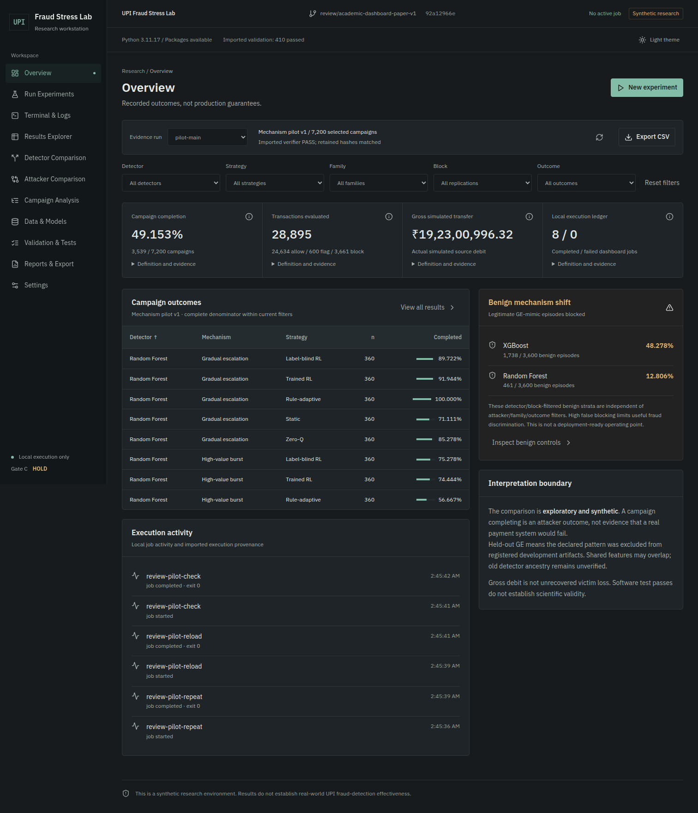
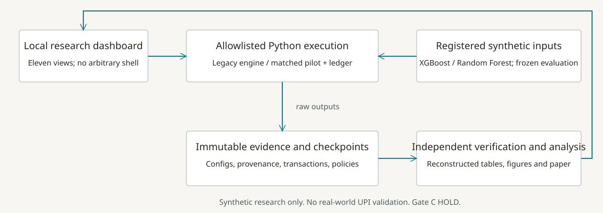
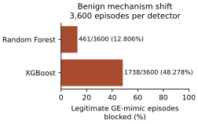

# UPI Fraud Stress Lab

A working, exploratory synthetic research workstation for studying whether sequences of adversarial transfers reach a target before detector intervention. It combines an existing Python ledger/campaign engine, XGBoost and Random Forest adapters, static/adaptive/learned attackers, an auditable matched pilot and a local dashboard.

**Synthetic research only. Results do not establish real-world UPI fraud-detection effectiveness. Gate C remains HOLD.** This is not connected to NPCI, banks or real payment accounts, and gross simulated debit is not actual victim loss or money saved.

## Start here

- **Review:** [Verification and final status](docs/VERIFICATION_REPORT.md), [academic paper PDF](research/paper/main.pdf), [paper source](research/paper/main.tex), [faculty demo](docs/REVIEW_DEMONSTRATION.md).
- **Use:** [Installation](docs/INSTALLATION.md), [dashboard guide](docs/DASHBOARD_GUIDE.md), [handover](docs/HANDOVER.md).
- **Understand:** [Methodology](docs/EXPERIMENT_METHODOLOGY.md), [metric definitions](docs/METRICS_AND_DEFINITIONS.md), [results](docs/RESULTS_AND_INTERPRETATION.md).
- **Assess novelty:** [Literature matrix](research/literature_review/comparison_matrix.csv), [qualified contribution analysis](research/literature_review/NOVELTY_ANALYSIS.md), [presentation outline](research/review_materials/presentation_outline.md), [faculty Q&A](research/review_materials/questions_and_answers.md).

## Verified quick start

Linux/WSL2 and Python 3.11 are the verified execution target. A fresh isolated Python 3.11 installation from the lock was tested during integration; do not assume native Windows, macOS or another dependency set is equivalent.

```sh
git clone --branch review/academic-dashboard-paper-v1 \
  https://github.com/YuvakarthikKoduri/Campaign-Level-Adversarial-Stress-Testing-of-UPI-Fraud-Detection-Systems.git
cd Campaign-Level-Adversarial-Stress-Testing-of-UPI-Fraud-Detection-Systems
python3.11 -m venv .venv
. .venv/bin/activate
python -m pip install -r requirements-milestone1.lock
python -B scripts/restore_evidence.py
python -B -s run_dashboard.py --port 8765
```

Open [the local dashboard](http://127.0.0.1:8765). Keep the Git checkout: the legacy runner records Git context. Do not bind or proxy this service publicly.



Restoration verifies the 10.5 MB bundled, deduplicated archive and reconstructs 715 exact preserved files into ignored `.local/retained/`. It includes main/repeat/reload pilot evidence, prior short legacy evidence and corrected full legacy evidence; it does not run experiments. New jobs/logs are separate under `.local/dashboard-state/`. See [artifact handling](results/artifacts/README.md).

## Research questions and architecture

We ask how matched policy constraints change simulated campaign completion, whether a declared synthetic mechanism exclusion implies useful discrimination on benign lookalikes, and whether records/policy state can be independently reconstructed. Campaign endpoints supplement transaction-level AUC by measuring stopping, target completion and ledger effects; they do not replace operational detector evaluation.



The Python engine retains separate legacy and pilot execution paths. A fixed-argument subprocess adapter connects the local dashboard to supported CLIs; record parsing and evidence reconstruction remain separate from execution and presentation. See [architecture and source map](docs/ARCHITECTURE.md).

## Implemented scope

| Component | Status and boundary |
|---|---|
| Legacy campaign engine | Implemented/tested: HIGH_VALUE_BURST, SLOW_DRAIN, GRADUAL_ESCALATION, BENEFICIARY_HOPPING; two detectors; static, rule-adaptive, RL and zero-Q workflows |
| Matched pilot | Implemented/tested: five arms including explicit-label-blind RL; HVB/GE; registered synthetic mechanism exclusion; benign calibration/shift controls |
| Local dashboard | Eleven working sections; real allowlisted jobs, logs, cancellation, filters, drill-down, artifact provenance and CSV/Markdown/SVG exports |
| Evidence | Immutable bundled raw outputs, hashes, checkpoint identities, independent arithmetic/TD reconstruction and short reproduction workflows |
| Scientific generalization | Not established: historical detector ancestry, general unseen fraud, universal RL gains, powered confirmatory study, real-world effectiveness |
| Academic package | Original AI-assisted IEEE draft, literature matrix, figures/tables and review materials; author/venue approval and external checker reports pending |

## Verified retained findings

The following is the **full mechanism-pilot v1 main run**, not a fresh short demo and not a combination with legacy evidence.

| Quantity | Verified record-derived value |
|---|---:|
| Independent blocks / detector fits | 9 / 18 |
| Evaluated attack campaigns / completed | 7,200 / 3,539 (49.153%, descriptive pooled total) |
| Evaluated transactions | 28,895 |
| ALLOW / FLAG / BLOCK | 24,634 / 600 / 3,661 |
| Gross simulated source debit | INR 192,300,996.32 |
| XGBoost legitimate GE-mimic BLOCK | 1,738/3,600 (48.278%) |
| Random Forest legitimate GE-mimic BLOCK | 461/3,600 (12.806%) |

Both detectors have zero observed BLOCK on 3,600 ordinary-benign test episodes each; that is not a guaranteed population false-block rate. The substantial benign-shift failure is central, not a footnote. Rule feedback helps completion on GE under this protocol, while RL-control contrasts depend on the detector. No adaptation paradox or general RL superiority is established.

[Consolidated results](results/results_summary.csv), [benign controls](results/comparison_tables/benign_controls.csv), [paired contrasts](results/comparison_tables/paired_contrasts.csv) and [separate legacy table](results/comparison_tables/legacy_separate.csv) are regenerated from raw records. The corrected legacy study has 1,152 campaigns/4,161 transactions/three seeds and different comparison conditions; do not pool it with the pilot.



## Execute, test and reproduce

```sh
# Small real workflow: both engines, main/repeat/reload, both checkers.
# Refuses to overwrite an existing .local/review-demo directory.
python -B scripts/review_smoke.py

# Independent reconstruction; no training or experiment execution:
python -B scripts/reproduce_paper.py
python -B verify_mechanism_pilot.py \
  --reference .local/retained/pilot-main --repeat .local/retained/pilot-repeat \
  --reload .local/retained/pilot-reload --output .local/pilot-verification-new.json

# Exact integrated selection; overlapping repeat runs are not extra distinct tests.
python -B -m pytest \
  tests/test_core.py tests/test_milestone1.py tests/test_gate_b.py \
  tests/test_prototype_rl.py tests/test_mechanism_pilot.py tests/test_mechanism_cli.py \
  tests/test_artifact_restore.py test_timing.py test_vpa_strategies.py \
  examples/test_environment.py closeout-tests/test_independent.py \
  f5-evidence/test_schema.py dashboard/test_dashboard.py -q

# Optional figures and paper:
python -m pip install -r requirements-research.txt
python -B scripts/reproduce_paper.py --figures
(cd research/paper && tectonic main.tex --keep-logs)
```

The integrated selection passed **478 distinct tests**: 420 core/legacy/pilot/independent/F5/artifact cases and 58 dashboard cases, with zero failures, skips or deselections. Earlier 410, 467 and 477 counts describe earlier scopes; repeated 47-case RL runs overlap and are never added. See exact evidence and failed attempts in the [verification report](docs/VERIFICATION_REPORT.md).

Full retained pilot reconstruction passes 1,012,673 verifier checks, including replay of 30,985 recorded TD updates. Separate paper reconstruction passes 44,608 record/hash/arithmetic checks. These are not test-case counts, additional campaigns or new independent replications. No expensive full study was rerun.

## Academic status, limitations and citation

The engineering demonstration is suitable for academic review within the executed Linux scope. This is **not yet an unqualified submission-ready manuscript**: human authors must approve the text, supply identities/venue, review AI-use policy, and obtain genuine university-approved AI-content and similarity reports for the exact final PDF. Both requirements are [PENDING EXTERNAL VERIFICATION](research/review_materials/EXTERNAL_CHECKS.md); no percentage is claimed.

The new pilot excludes the declared GE mechanism from registered synthetic detector-development data. This does not repair historical detector ancestry or prove all evaluation fraud is unseen. Nine exploratory blocks, two pilot mechanisms, unequal offline training costs, high benign-shift blocking and no external validation bound every claim. [Limitations and future work](docs/LIMITATIONS_AND_FUTURE_WORK.md) distinguish unperformed research from completed engineering.

For citation metadata use [CITATION.cff](CITATION.cff), and cite the exact reviewed commit and artifact hashes. [Contributing](CONTRIBUTING.md) requires preservation, source-bound claims and no Gate C actions. No new project-wide license grant is selected by this integration; see [LICENSE](LICENSE). Earlier reports in [history](docs/history/README.md) are preserved but superseded for current commands/counts.

The [CI definition](docs/ci/README.md) is supplied as a non-executing review template because the connected OAuth app cannot add workflow files. All reported checks were actually run locally; GitHub Actions activation and any remote CI result are not claimed.
